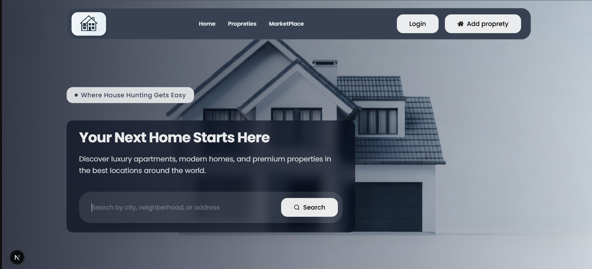
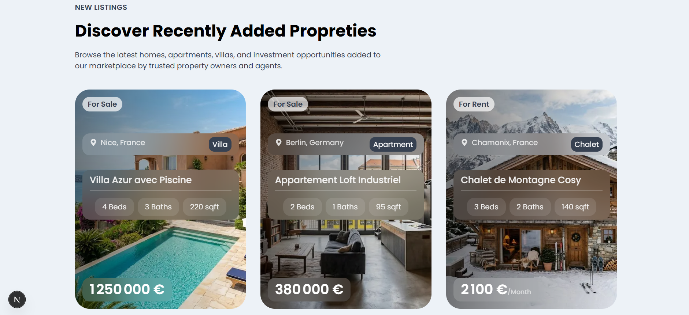

# House Market
>  Trouvez votre prochain bien immobilier : appartements, maisons et villas à acheter ou à louer sur House Market.


  *Home page*


  *Section des propriétés récentes*

## Fonctionnalités

- **Accueil** : une barre de recherche permet de trouver un bien par ville, quartier ou adresse ; les annonces les plus récentes sont affichées juste en dessous.

- **Authentification** : inscription et connexion par email + mot de passe, ainsi qu'une connexion Google en un clic (tout est géré par better-auth)

- **Marketplace** : la page liste toutes les propriétés disponibles sur le site et accepte des filtres combinables (type de bien, localisation, fourchette de prix).

- **Détails d'une propriété** : description complète, caractéristiques (surface, chambres,prix etc.), et un formulaire pour contacter le propriétaire (l'envoi se fait par email grâce à Resend)

- **Propriétées** : un utilisateur connecté peut créer ses propres annonces en 6 étapes (type => localisation=> détails => description => photo => prix) et les retrouver sur une page listant uniquement ses biens.

## Stack technique

| Type             | Outil / Librairie                              |
| ---------------- | ---------------------------------------------- |
| Framework        | **Next.js 16.2** (App Router)                  |
| UI               | **React 19**                                   |
| Langage          | **TypeScript 5**                               |
| Style            | **TailwindCSS 4**                              |
| Icones           | **react-icons**                                |
| Gestion d'état   | **Zustand 5**                                  |
| Auth             | **better-auth** (email/password + Google OAuth)|
| ORM              | **Prisma 7**                                   |
| Base de données  | **PostgreSQL** (via Neon)                      |
| Upload d'images  | **Cloudinary**                                 |
| Emails           | **Resend** + **React Email**                   |
| Client HTTP      | **Axios**                                      |
| Utilitaires      | **clsx**                                       |


## Modèles de données (Prisma)

Le schéma Prisma définit 5 modèles:

| Modèle         | Description                                                       | Attributs |
| -------------- | ----------------------------------------------------------------- | --------- |
| `User`         | Utilisateur de l'application                                      | `id`, `name`, `email`, `emailVerified`, `image`, `createdAt`, `updatedAt` |
| `Account`      | Compte OAuth lié à un User | `id`, `accountId`, `providerId`, `userId`, `accessToken`, `refreshToken`, `idToken`, `accessTokenExpiresAt`, `refreshTokenExpiresAt`, `scope`, `password`, `createdAt`, `updatedAt` |
| `Session`      | Session active d'un utilisateur                                   | `id`, `token`, `expiresAt`, `createdAt`, `updatedAt`, `ipAddress`, `userAgent`, `userId` |
| `Verification` | Code de vérification utilisé par better-auth | `id`, `identifier`, `value`, `expiresAt`, `createdAt`, `updatedAt` |
| `Property`     | Annonce immobilière créée par un User | `id`, `title`, `description`, `propertyType`, `listingType`, `price`, `bedrooms`, `bathrooms`, `parkingSpaces`, `area`, `location`, `address`, `image`, `createdAt`, `updatedAt`, `ownerId` |

Relations principales :

- `User` **1-N** `Session` (cascade delete, via `userId`)
- `User` **1-N** `Account` (cascade delete, via `userId`)
- `User` **1-N** `Property` (cascade delete, via `ownerId`)


## Structure du projet

```
housemarket/
├── public/
│   └── images/
│       ├── avatar.png             # Mon avatar
│       ├── house_cover.png        # Image de fond du hero
│       ├── icon.png               # Icone du footer
│       ├── logo.png               # Logo du site
│       └── properties/            # Photos des annonces
│           ├── image1.jpg ... image8.jpg
├── prisma/
│   └── schema.prisma              # Schéma Prisma (User, Account, Session, Verification, Property)
├── src/
│   ├── app/
│   │   ├── globals.css            # Thème Tailwind + variables CSS
│   │   ├── layout.tsx             # Layout racine (polices, métadonnées, modales utilisés)
│   │   ├── page.tsx               # Page d'accueil
│   │   ├── marketplace/           # Page marketplace
│   │   │   └── page.tsx
│   │   ├── property/[propertyId]/ # Page détail d'une propriété
│   │   │   └── page.tsx
│   │   ├── (protected)/           # Routes protégées
│   │   │   ├── layout.tsx
│   │   │   └── properties/        # Page propriétés
│   │   │       └── page.tsx
│   │   └── api/
│   │       ├── auth/[...all]/     # Handler better-auth (signIn, signUp, OAuth...)
│   │       │   └── route.ts
│   │       ├── properties/        # Création et récupération d'une propriété
│   │       │   └── route.ts
│   │       └── send-email/        # Envoi d'une demande de contact au propriétaire
│   │           └── route.ts
│   ├── components/                # Composants
│   │   ├── emails/
│   │   │   └── inquiryEmail.tsx   # Template React Email (demande de contact)
│   │   ├── general/
│   │   │   └── Footer.tsx
│   │   ├── home/
│   │   │   ├── RecentProperties.tsx
│   │   │   └── SearchBox.tsx
│   │   ├── layout/
│   │   │   └── FrontendLayout.tsx # Wrapper (Navbar + Footer)
│   │   ├── marketplace/
│   │   │   └── FilterButton.tsx
│   │   ├── modals/                # Liste des modales
│   │   │   ├── Modal.tsx
│   │   │   ├── LoginModal.tsx
│   │   │   ├── RegisterModal.tsx
│   │   │   ├── CreatePropertyModal.tsx
│   │   │   └── FilterModal.tsx
│   │   ├── navbar/                # Navbar
│   │   │   └── Navbar.tsx
│   │   ├── properties/
│   │   │   ├── PropertyCard.tsx
│   │   │   ├── PropertyTypeCard.tsx
│   │   │   ├── Counter.tsx
│   │   │   ├── EmailForm.tsx      # Formulaire de contact 
│   │   │   └── ImageUpload.tsx
│   │   ├── skeletons/             # Skeletons de chargement
│   │   │   ├── CardSkeleton.tsx
│   │   │   └── PropertyPageSkeleton.tsx
│   │   └── ui/
│   │       ├── Button.tsx
│   │       ├── Input.tsx          # Input / Textarea
│   │       └── EmptyState.tsx
│   ├── constants/
│   │   ├── dummyProperties.ts     # Jeu de données (8 annonces)
│   │   └── PropertyTypes.ts       # Jeu de données (types de biens)
│   ├── database/
│   │   └── db.ts                  # Client Prisma partagé
│   ├── generated/prisma/          # Client Prisma généré
│   ├── lib/                       # Helpers
│   │   ├── auth.ts                # Instance better-auth (côté serveur)
│   │   ├── auth-client.ts         # Client better-auth (côté React)
│   │   ├── cloudinary.ts          # Config Cloudinary
│   │   └── resend.ts              # Instance du client Resend
│   ├── server-actions/            # Server Actions
│   │   ├── getAllProperties.ts
│   │   ├── getCurrentUser.ts
│   │   ├── getProperty.ts
│   │   ├── getRecentProperties.ts
│   │   └── getUserProperties.ts
│   ├── services/                  # Services client
│   │   ├── SignInWithGoogle.ts
│   │   └── cloudinary.ts
│   ├── store/                     # Stores (Zustand)
│   │   ├── useAuthModal.ts
│   │   ├── useCreatePropretyModal.ts
│   │   └── useFilterModal.ts
│   └── types/
│       ├── property.tsx           # Modèle (interface) d'une propriété
│       └── propertyType.tsx       # Modèle (interface) d'un type d'une propriété
├── eslint.config.mjs
├── next.config.ts
├── postcss.config.mjs
├── tailwind.config (via @theme)
├── tsconfig.json
└── package.json
```

## Démarrage

### Pré-requis

- **Node.js 20+**
- **npm**
- Une base **PostgreSQL** (Neon ou autre) 
- Un compte **Cloudinary** pour l'upload d'images
- Un compte **Resend** pour l'envoi d'emails
- Un projet **Google Cloud** (OAuth) si vous voulez activer la connexion Google

### Variables d'environnement

Créez un fichier `.env` à la racine à partir de `.env.example`:

| Variable | Description |
| -------- | ----------- |
| `DATABASE_URL` | URL de la base PostgreSQL (connexion pooler) |
| `DIRECT_URL` | URL directe à la base PostgreSQL (utilisée par Prisma CLI pour les migrations) |
| `BETTER_AUTH_SECRET` | Secret utilisé par better-auth pour signer les sessions |
| `BETTER_AUTH_URL` | URL de l'application (exp: `http://localhost:3000`) |
| `GOOGLE_CLIENT_ID` | Client ID OAuth Google |
| `GOOGLE_CLIENT_SECRET` | Client Secret OAuth Google |
| `CLOUDINARY_CLOUD_NAME` | Cloud name Cloudinary |
| `CLOUDINARY_API_KEY` | API key Cloudinary |
| `CLOUDINARY_API_SECRET` | API secret Cloudinary |
| `RESEND_API_KEY` | Clé d'API Resend |
| `EMAIL_FROM` | Adresse d'expéditeur (exp: en mode dev `onboarding@resend.dev`) |
| `NEXT_PUBLIC_URL` | URL de l'application (exp: `http://localhost:3000`) |

> En mode dev, l'offre gratuite Resend n'autorise l'envoi **qu'à l'adresse qui a créé le compte** (il faut adapter le destinataire dans `src/app/api/send-email/route.ts`).

### Installation

```bash
# 1. Cloner le dépot
git clone https://github.com/missipsa-bouhadad/housemarket.git
cd housemarket

# 2. Installer les dépendances
npm install

# 3. Configurer les variables d'environnement
=> Créer le fichier '.env' à la racine a partir de '.env.example', puis remplissez le

# 4. Générer le client Prisma
npx prisma generate

# 5. Appliquer le schéma à la base
npx prisma migrate dev

# 6. Lancer le serveur
npm run dev
```

L'application est ensuite disponible sur
[http://localhost:3000](http://localhost:3000).

## Remarques

### Jeu de données (properties)

Le fichier `src/constants/dummyProperties.ts` contient 8 annonces que vous pouvez utiliser pour peupler la base. Pensez à remplacer chaque `ownerId` par le champ `id` d'un utilisateur existant dans la table `User` avant insertion.

### Resend en mode dev

L'offre gratuite de Resend n'autorise l'envoi d'emails **qu'à l'adresse qui a créé le compte**. Pensez à remplacer le `to: "your_email"` dans `src/app/api/send-email/route.ts` par cette adresse avant de tester le formulaire de contact.


